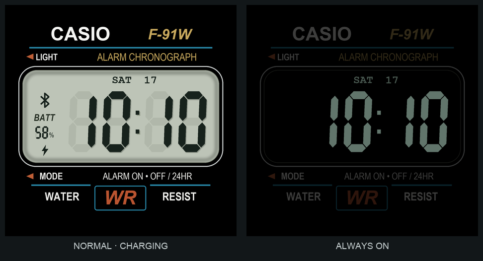

# Casio-inspired watchface for Xiaomi Watch S1 Active

A retro LCD watchface inspired by the Casio F-91W, built for the **466 × 466 Xiaomi Watch S1 Active** using the EasyFace Gen2 format.

## Preview

These are **rendered previews generated from the source**, not photographs or screenshots captured from the watch. Example values are fixed in the previews; the installed face uses live watch data.



The normal face includes:

- Thick, aligned seven-segment digits with faint inactive segments and LCD shadows.
- 24-hour time, weekday and day of month.
- Battery percentage, Bluetooth connection icon and a charging lightning bolt.
- No outer circular white border.

The always-on face keeps the Casio styling with a black display background, dim lettering, time and date. It omits battery and connection indicators. Darker pixels are intended to reduce OLED power consumption; battery savings have not been measured.

## Download and install

Download `casio-time-s1-active-v4.bin` from [Releases](https://github.com/rephus/casio-watchface-s1-active/releases).

With Notify for Xiaomi connected to your watch:

1. Copy the `.bin` to your phone.
2. Open **Device → Watchfaces → menu → Custom watchface (.bin)**, or **Device → Device tools → Update watchface**.
3. Select the file and choose **Install**.
4. Keep the watch close and wait for the completion message. The progress indicator may remain at 99% before completion.

Menu wording depends on language and app version. Notify needs the watch pairing key and an exclusive Bluetooth connection; Mi Fitness may need to be force-stopped or have its Nearby devices permission temporarily disabled. Do not unpair or reset the watch just to switch companion apps.

Notify can show a model-compatibility warning. This build targets **S1 Active**, not arbitrary Xiaomi, Redmi, Lite or Pro models. Uploading an already-installed ID may be rejected; select the existing face on the watch instead. Version 4 uses face ID `917101703`.

**Verification:** the earlier Casio design was physically confirmed on an S1 Active. Notify 23.9.0 reported a successful upload for this v4 build on stock firmware 1.4.174. Physical rendering of the latest changes, live Bluetooth/charging transitions and AOD behavior still need confirmation.

## Source layout

| File | Purpose |
| --- | --- |
| [`scripts/build-casio-face.py`](scripts/build-casio-face.py) | Draws assets and generates the normal/AOD projects and previews |
| [`watchfaces/casio-time/CasioTime.fprj`](watchfaces/casio-time/CasioTime.fprj) | Generated normal-screen EasyFace project |
| [`watchfaces/casio-time/AOD/AOD.fprj`](watchfaces/casio-time/AOD/AOD.fprj) | Generated always-on project |
| [`scripts/compile-casio-face.sh`](scripts/compile-casio-face.sh) | Compile through a locally configured Wine/Docker environment |
| [`scripts/package-casio-face.py`](scripts/package-casio-face.py) | Validate the Gen2 container and package the installable binary |

Edit the Python generator rather than the generated project files.

## Generate graphics and previews

The current generator uses **macOS system fonts** from `/System/Library/Fonts/Supplemental`: Arial, Arial Narrow and Courier New variants. Fonts are not bundled. On other operating systems, adjust `FONT` and font names to fonts you have installed; substitutions may alter the layout.

```sh
python3 -m venv .venv
source .venv/bin/activate
pip install -r requirements.txt
python3 scripts/build-casio-face.py
```

Previews and assets are written under `watchfaces/casio-time/`. The preview shows Saturday 17, 10:10 and 58% battery as sample data.

## Compile

The checked-in generated assets allow compilation without regenerating the graphics or installing the drawing fonts.

Use the [EasyFace Gen2 v4.23 compiler](https://github.com/m0tral/EasyFace/releases/tag/v4.23). Third-party compiler binaries are not included in this repository. From its directory on Windows, compile the project with paths adjusted to your checkout:

```bat
Compiler.exe -b C:\path\to\repo\watchfaces\casio-time\CasioTime.fprj C:\path\to\repo\watchfaces\casio-time\output CasioTime.face 1731859101
```

The adjacent `AOD/AOD.fprj` supplies the second layout. Then run from the repository root:

```sh
python3 scripts/package-casio-face.py
```

This creates the `.bin`, ZIP, source ZIP and build report in `dist/`. Packaging assigns the published face ID and checks the Gen2 header, two layout slots, numeric data sources and battery assets.

The shell build script is the workflow used during development. It requires Docker, a preconfigured image named `s1-face-builder:local` with 32-bit Wine, Wine Mono and Xvfb, and the compiler files in `.toolchain/easyface-compiler/`. **That local image is not supplied**, so the script is not a one-command clean-machine setup.

```sh
bash scripts/compile-casio-face.sh
```

A compiler message about uploading to an emulator does not mean the physical watch was updated. Transfer the resulting `.bin` separately through Notify.

## Live data

The declarative face uses native Gen2 data sources: hour/minute digits, weekday (`2012`, Sunday first), day of month (`1812`), battery (`0841`), charging (`1041`) and Bluetooth (`2041`). It contains no network requests, accounts, credentials or phone-specific configuration.

## Credits

- [m0tral/EasyFace](https://github.com/m0tral/EasyFace): Gen2 compiler and tooling.
- [Mi-Create](https://github.com/ooflet/Mi-Create): project-format and binary-format reference.
- [Notify for Xiaomi](https://www.mibandnotify.com/): direct watchface transfer.

This is an unofficial fan project, not affiliated with Casio or Xiaomi. Product names and marks belong to their respective owners. No third-party font or compiler binaries are distributed.
